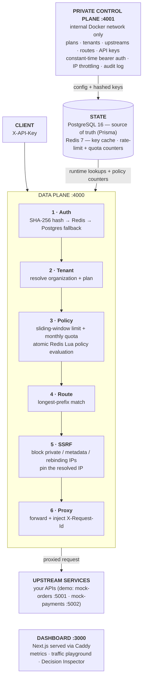
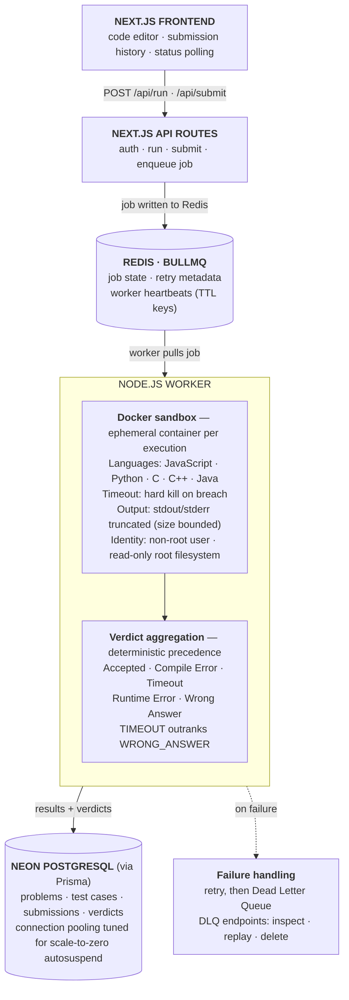

<h1 align="center">Manas Bhardwaj</h1>

<h3 align="center">Software Engineer &nbsp;·&nbsp; Full-Stack & Backend Systems</h3>

  
  &nbsp;
  
  &nbsp;
  
  &nbsp;
  
  &nbsp;
  

<b>3</b> live deployments &nbsp;·&nbsp; <b>108</b> tests in GateForge &nbsp;·&nbsp; <b>5</b> projects

---

I build full-stack software — React and Next.js interfaces on top of backend systems I design for failure: an API gateway, a sandboxed code-execution engine, and distributed job queues. I focus on what happens when things break — burst traffic, hostile code, failed jobs. Previously at **Emendo AI**.

---

## Featured Systems

### GateForge — Programmable API Gateway

> `TypeScript · Node.js · Express · Redis (Lua) · PostgreSQL · Prisma · Next.js · Docker · Azure · Caddy`
>
> A multi-tenant API gateway built from first principles. It implements its own request pipeline for authentication, rate limiting, quota enforcement, route matching, and SSRF protection.
>
> **Interface:** Next.js dashboard with live metrics, a traffic playground, and a per-request Decision Inspector.

**Key decisions:**
- **Atomic rate limiting:** Sliding-window limits and monthly quotas are checked in a single Redis Lua script — one roundtrip, no distributed lock, no check-then-increment race under concurrent bursts.
- **SSRF defense in two phases:** Upstream targets are validated when routes are defined and re-validated at connection time with IP pinning, covering private subnets, link-local and cloud-metadata addresses, and DNS rebinding.
- **Control plane never public:** The admin API runs on `:4001` inside the internal Docker network and is never exposed through Caddy. API keys are stored only as SHA-256 hashes.

**108 Vitest tests across 11 suites** &nbsp;·&nbsp; [Live Demo](https://gateforgeapp.duckdns.org) &nbsp;·&nbsp; [Source Code](https://github.com/ManasBhardwaj07/GateForge)

---

### CodeForge — Sandboxed Code Execution Platform

> `Next.js · TypeScript · BullMQ · Redis · Docker · Prisma · Neon PostgreSQL · Azure · Caddy`
>
> An asynchronous, queue-backed platform running untrusted code across 5 languages (JavaScript, Python, C, C++, Java), engineered for deterministic execution and operational resilience under abusive workloads.
>
> **Interface:** Next.js app with a code editor, submission history, and live status polling.

**Key decisions:**
- **Untrusted code, contained:** Every execution runs in a newly spawned, ephemeral Docker container with a hard timeout, output truncation, a non-root user, and a read-only root filesystem.
- **Run vs Submit:** An ephemeral `Run` path with custom input vs. a DB-backed `Submit` path tested against hidden cases, with a deterministic verdict hierarchy (`TIMEOUT` strictly outranks `WRONG_ANSWER`).
- **Designed for failure:** Redis TTL heartbeats feed queue-health endpoints, failed jobs land in an inspectable Dead Letter Queue, and dedicated scripts test infinite loops, stdout flooding, orphan-container cleanup, and worker hard-kill recovery.

[Live Demo](https://codeforgeapp.duckdns.org) &nbsp;·&nbsp; [Source Code](https://github.com/ManasBhardwaj07/CodeForge)

---

## Projects

| Project | What it solves | Stack | Key Outcomes |
|---|---|---|---|
| **[GateForge](https://github.com/ManasBhardwaj07/GateForge)** | Multi-tenant API gateway: auth, rate limiting, routing, and observability | TypeScript, Node.js, Express, Redis (Lua), PostgreSQL, Next.js, Docker, Azure | Atomic Lua rate limiting · two-phase SSRF defense · plane isolation · 108 tests |
| **[CodeForge](https://github.com/ManasBhardwaj07/CodeForge)** | Sandboxed multi-language code execution with deterministic verdict aggregation | Next.js, TypeScript, BullMQ, Redis, Docker, Prisma, Neon PostgreSQL, Azure | Container isolation · deterministic verdicts · DLQ and worker heartbeats · abuse-tested |
| **[ApexDrive](https://github.com/ManasBhardwaj07/ApexDrive)** | Subscription rewards platform with a monthly draw engine and charitable giving | React, Vite, Node.js, Supabase, PostgreSQL, Stripe | 4 Stripe webhook lifecycle events · Row Level Security · DB-trigger score window · admin analytics |
| **[ProjectHub](https://github.com/ManasBhardwaj07/ProjectHub)** | Real-time collaborative workspace with multi-user sync | React, Node.js, Express, Socket.IO, MongoDB Atlas, JWT | Drag-and-drop React UI · live WebSocket sync · RBAC · tokenized password reset |
| **[QueueForge](https://github.com/ManasBhardwaj07/QueueForge)** | Asynchronous distributed job processing with worker isolation | Node.js, BullMQ, Redis, MongoDB, Docker Compose, AWS EC2 | Exponential backoff · retryable/permanent failure classification · 10/10 jobs completed in documented burst test |

---

## Tech Stack

| Layer | Technologies |
|---|---|
| **Languages** |     |
| **Backend & Queues** |      |
| **Frontend** |      |
| **Databases & ORM** |      |
| **Cloud & DevOps** |        |
| **Security & Payments** |      |

---

<i>Systems that hold under burst traffic, contain hostile code, and recover from failure — every claim above links to code you can read.</i>

